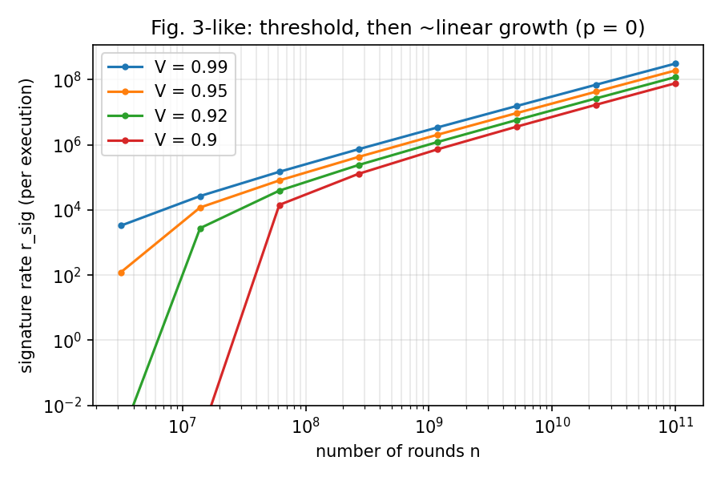
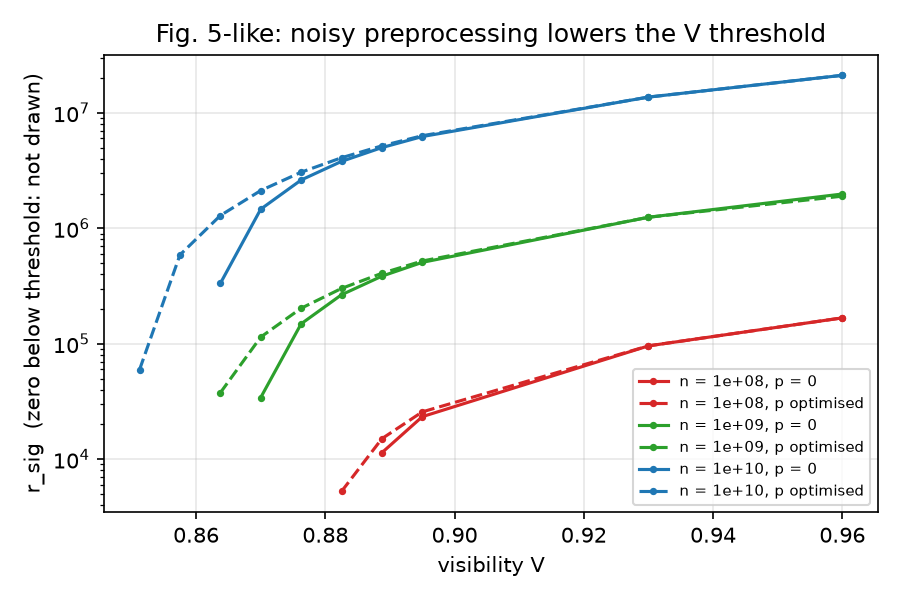

# diqds — device-independent quantum digital signatures, reimplemented from the paper

Python reimplementation of **Fan, Bian, Li, Wen, Yin, Chen, "Device-independent quantum digital signatures under
realistic conditions", Phys. Rev. A 114, 032617 (2026)**, with Qiskit for the quantum devices.
The finite-size key bound was reconstructed from its sources (Tan et al., Quantum 6, 880, arXiv:2012.08714;
Ho et al., PRL 124, 230502, arXiv:2005.13015) because the PDF's math is garbled, then **validated against the numbers
printed in the paper**.

**Contents:** [1. Run everything, one step at a time](#1-run-everything-one-step-at-a-time) ·
[2. Where the output goes](#2-where-the-output-goes) · [3. Troubleshooting](#3-troubleshooting) ·
[4. Use it from your own code](#4-use-it-from-your-own-code) · [5. Reference](#5-reference-what-is-implemented-and-how-well-it-matches)

---

## 1. Run everything, one step at a time

Rules for every step below:

* Run the commands from the **project folder** (the one that contains this README, `scripts/`, `diqds/` and `tests/`).
* Call tests as `python -m pytest`, never bare `pytest` (see [Troubleshooting](#3-troubleshooting)).
* Use `python3` (or `py` on Windows) if `python` is not found.
* Times were measured on one ordinary machine; expect the same order of magnitude. The finite-size analysis is
  deterministic; only the demo uses random numbers (seed 1 by default), so its counts change slightly with library versions.

**Steps 1-5 are the core path (about 9 minutes). Steps 6-8 are optional deeper checks (about 17 minutes more).**

| Step | What it does | Command | Time |
|---|---|---|---|
| 0 | install and check the environment | see below | 1-2 min |
| 1 | self-test (59 tests) | `python -m pytest -q` | 45 s |
| 2 | whole signature system: quantum devices → keys → signatures | `python scripts/demo_end_to_end.py` | 10 s |
| 3 | which published experiments are feasible (paper's Fig. 6) | `python scripts/reproduce_fig6_claims.py` | 1 min |
| 4 | minimum-visibility thresholds vs the paper (Fig. 5) | `python scripts/reproduce_thresholds.py` | 3 min |
| 5 | **the graphs** (`fig3_like.png`, `fig5_like.png`) | `python scripts/plot_signature_rates.py --which fig3 --quick`, then `--which fig5 --quick` | 1 + 2.5 min |
| 6 | full side-by-side with the paper | `python scripts/compare_with_paper.py --part ...` (9 parts), then `--report` | 10 min |
| 7 | tables for the follow-up paper | `python scripts/reproduce_paper_tables.py` | 2 min |
| 8 | regression tests against the paper's printed numbers | `python -m pytest -q -m slow` | 6 min |

### Step 0 — Set up (once)

```bash
cd diqds_project
python -m venv .venv
source .venv/bin/activate        # Windows PowerShell: .venv\Scripts\Activate.ps1     Windows cmd: .venv\Scripts\activate.bat
pip install -r requirements.txt
python -c "import qiskit, qiskit_aer, numpy, scipy, matplotlib; print('qiskit', qiskit.__version__, '| aer', qiskit_aer.__version__)"
```

You should see a line like `qiskit 2.6.0 | aer 0.17.2` (those are the tested versions; any recent Qiskit 1.x/2.x works).
Python 3.10 or newer is required.

### Step 1 — Self-test

```bash
python -m pytest -q
```
```
...........................................................              [100%]
59 passed, 9 deselected in 46.36s
```

All tests pass; the 9 "deselected" tests are the slow ones that Step 8 runs. **If you see fewer than 59 passed, Qiskit is not
visible to the Python that runs pytest** (the quantum and protocol test files are then skipped silently) — see
[Troubleshooting](#3-troubleshooting). If anything fails, fix it before going on.

### Step 2 — End-to-end signature system

```bash
python scripts/demo_end_to_end.py
```
```
security (Table I): eps=1e-10, eps_snd=5e-11, n_m=1000 -> n_s = 46 (138 key bits per signature and link)
plan: n=2,000,000  gamma=0.0586  p=0.0000  omega_thr=0.84664  EC_max=184,914  tag=61 bits  ->  ell=181,841 secret bits (0.0909 per round)

[Alice-Bob] ACCEPTED   (3.4s, backend=exact)
   test rounds 117,588  CHSH losses 17,683 <= 17,969   S_hat = 2.797   QBER(key) = 0.0051
   EC leakage 166,268 <= EC_max 184,914   verification hash ok = True
   secret key: 181,841 bits, Alice/partner copies equal = True

[Alice-Charlie] ACCEPTED   (3.5s, backend=exact)
   test rounds 117,240  CHSH losses 17,731 <= 17,969   S_hat = 2.790   QBER(key) = 0.0050
   EC leakage 165,469 <= EC_max 184,914   verification hash ok = True
   secret key: 181,841 bits, Alice/partner copies equal = True

signature capacity of this execution: 1317  (r_sig = ell/(3 n_s) = 1317.7)

-- messaging stage (Fig. 2)
   Transfer 100 EUR to Bob      Bob accepts: True   Charlie accepts: True
   Contract v2 - final          Bob accepts: True   Charlie accepts: True
   Bob forwards a modified document -> Charlie accepts: False   (forgery rejected)

-- sanity: devices without entanglement
    aborted: CHSH test failed: 29,606 losses > 17,969 allowed (S_hat = 1.984)
```

What happened, in order: (1) Eq. (9) was optimised for the expected devices and fixed the protocol parameters;
(2) Alice–Bob and Alice–Charlie each ran the 7-step device-independent key generation on their own Qiskit device pair
(the three checks — CHSH losses below the threshold, error-correction leakage within `EC_max`, verification hash — all passed);
(3) the two keys became 1317 one-time signature keys; (4) Bob and Charlie accepted honest signatures, and Charlie
rejected a document that Bob modified before forwarding; (5) unentangled devices were rejected by the CHSH test.
Your counts will differ slightly; what matters is `ACCEPTED`, `True`, `forgery rejected`, and `aborted`.

Variations (each is a separate run; the output has the same format):

```bash
python scripts/demo_end_to_end.py --backend aer                      # CHSH circuits executed on qiskit-aer, ~20 s
python scripts/demo_end_to_end.py --variant standard --n 1000000     # the no-sifting protocol variant, ~8 s
python scripts/demo_end_to_end.py --V 0.98 --n 3000000               # noisier devices need more rounds
python scripts/demo_end_to_end.py --V 0.97 --n 5000000 --ec oracle   # see the note below
```

Options: `--n` rounds per link, `--V` Werner-state visibility (device quality), `--backend exact|aer`,
`--ec cascade|oracle`, `--variant rkm|standard`, `--seed`. Two outcomes you may meet when you experiment:

* `no key at these parameters - increase --n or --V` (for example `--V 0.90 --n 1000000`): the finite-size bound is not positive, so nothing is run.
* `ABORTED: error-correction budget exhausted` (for example `--V 0.97 --n 5000000`): the real Cascade code is about 15 % above the
  Shannon limit and sends test-round bits raw, so below V ≈ 0.98 it overruns the paper's `EC_max` and the protocol correctly aborts.
  `--ec oracle` models the ideal code the paper assumes; with it that same run is accepted (568,493 secret bits).

### Step 3 — Which published experiments are feasible (Fig. 6)

```bash
python scripts/reproduce_fig6_claims.py
```
```
n_s = 46  (Table I)

Nadlinger et al., Nature 607, 682 (ions, 2 m)
   S=2.677, Q=0.0144, collected 1,500,000 rounds in 7.9 h
   paper: 1.5e6 rounds (~8 h) are within the acceptable range -> feasible
   [standard  ] n_min =       950,384  ->           5 h at the experiment's rate;  ell at collected n =    135,159  (feasible)
   [rkm_sifted] n_min =     2,460,758  ->          13 h at the experiment's rate;  ell at collected n =    -89,106  (not enough rounds)

Zhang et al., Nature 607, 687 (Rb atoms, 400 m)
   S=2.578, Q=0.0779, collected 3,342 rounds in 75 h
   paper: would need 'on the order of 1e7 hours' (3342 rounds per 75 h)
   [standard  ] n_min =    25,813,145  ->     579,290 h at the experiment's rate;  ell at collected n =    -16,207  (not enough rounds)
   [rkm_sifted] n_min =    52,688,782  ->   1,182,423 h at the experiment's rate;  ell at collected n =    -10,812  (not enough rounds)

Lu et al., Science 391, 592 (Rb atoms, 11 km)
   S=2.612, Q=0.0285, collected 1,208,000 rounds in 624 h
   paper: more than the collected 1.2e6 rounds needed; positive at 2.4e6 (~1248 h)
   [standard  ] n_min =     2,169,625  ->       1,121 h at the experiment's rate;  ell at collected n =   -114,842  (not enough rounds)
   [rkm_sifted] n_min =     5,539,598  ->       2,862 h at the experiment's rate;  ell at collected n =   -197,433  (not enough rounds)
```

How to read it: for each experiment, `n_min` is the number of rounds needed for a positive signature key, and the hours
column converts that at the experiment's own event rate. The `standard` lines match the paper's statements for
Nadlinger (feasible) and Lu (needs more than the 1.208×10⁶ collected, fewer than 2.4×10⁶). For Zhang the code gives
10⁵·⁸–10⁶·² hours against the paper's "order 10⁷" — the one place that does not match (see §5).

### Step 4 — Fig. 5 thresholds vs the paper

```bash
python scripts/reproduce_thresholds.py
```
```
variant = rkm_sifted  (key_weight=0.5, EC model=sifted)
       n |  V_min p=0   paper    diff | V_min p opt   paper    diff
   1e+08 |     0.8828  0.8835 -0.0007 |      0.8788  0.8799 -0.0011   [33s]
   1e+09 |     0.8681  0.8686 -0.0005 |      0.8602  0.8608 -0.0006   [64s]
   1e+10 |     0.8618  0.8622 -0.0004 |      0.8504  0.8508 -0.0004   [84s]
```

`V_min` is the smallest device visibility that still yields a signature; "p opt" uses optimised noisy preprocessing.
All six values agree with the paper to about 10⁻³. The last digit can differ by ±1 from the table in §5 because this
default run uses a coarser bisection tolerance. Options: `--only 1e9` (one row, ~1 min), `--skip-np` (skip the
optimised-p column; `--only 1e8 --skip-np` takes ~10 s), `--tol 5e-5` (finer, ~5 min), and `--variant standard`, which
runs the no-sifting reading: it gives V_min = 0.8755 at n = 10⁸ against the paper's 0.8835, i.e. it does *not* reproduce
Fig. 5 (that figure belongs to the sifted reading; the standard reading is the one that matches Fig. 6, Step 3).

### Step 5 — The graphs

```bash
python scripts/plot_signature_rates.py --which fig3 --quick     # about 1 minute
python scripts/plot_signature_rates.py --which fig5 --quick     # about 2.5 minutes
```
```
computing Fig. 3-like data (r_sig vs n, p = 0) ...
saved /your/path/diqds_project/fig3_like.png
done - open the PNG file(s) above with any image viewer
```
```
computing Fig. 5-like data (r_sig vs V, p = 0 and optimised p) ...
saved /your/path/diqds_project/fig5_like.png
done - open the PNG file(s) above with any image viewer
```

The graphs are written as PNG files into the project folder (no window pops up). Open them with your image viewer or:
`open fig3_like.png` (macOS), `start fig3_like.png` (Windows), `xdg-open fig3_like.png` (Linux).

**`fig3_like.png`** — signature rate against the number of rounds, for several device qualities V. Each curve is zero below a
finite-size threshold (a worse device needs more rounds: n_min = 1.1×10⁶ for V = 0.99, 3.1×10⁶ for 0.95, 8.8×10⁶ for 0.92,
2.5×10⁷ for 0.90), then rises steeply and settles on a straight line of slope 1 on the log-log axes, i.e. linear growth in n.



**`fig5_like.png`** — signature rate against visibility V for n = 10⁸, 10⁹, 10¹⁰. Solid: no noisy preprocessing; dashed: optimised
noisy preprocessing. Each dashed curve starts at lower V than its solid partner (at n = 10¹⁰ the threshold moves from 0.862 to
0.850), which is the paper's noisy-preprocessing result. Rates that are exactly zero are not drawn (log axis).



Options: `--out DIR` writes the PNGs elsewhere, `--which both` makes both in one go (about 3.5 minutes), and leaving out
`--quick` uses a grid about 1.7× finer (smoother curves, proportionally longer).

### Step 6 — Full side-by-side with the paper (optional)

`scripts/compare_with_paper.py` recomputes the paper's results part by part and stores them in `results/*.json`.
`--report` then assembles them into one table (`COMPARISON.md`). Run the parts in any order:

```bash
python scripts/compare_with_paper.py --part thresholds --n 1e8     # ~50 s   Fig. 5, row n = 1e8
python scripts/compare_with_paper.py --part thresholds --n 1e9     # ~80 s   Fig. 5, row n = 1e9
python scripts/compare_with_paper.py --part thresholds --n 1e10    # ~95 s   Fig. 5, row n = 1e10
python scripts/compare_with_paper.py --part fig4a                  # ~100 s  Fig. 4: threshold for fixed p, n = 1e10
python scripts/compare_with_paper.py --part fig4b                  # ~95 s   Fig. 4: signature rate for fixed p
python scripts/compare_with_paper.py --part fig3                   # ~80 s   Fig. 3: n_min and growth slope
python scripts/compare_with_paper.py --part fig6                   # ~65 s   Fig. 6: the three experiments
python scripts/compare_with_paper.py --part misc                   # ~20 s   Table I, message length, completeness
python scripts/compare_with_paper.py --part photonic               # ~15 s   Fig. 7 consistency estimate (not a reproduction)
python scripts/compare_with_paper.py --report                      # ~1 s    prints the assembled table
```

Typical single-line outputs:

```
n=1e+08: V_min(p=0)=0.8827 (paper 0.8835)  V_min(p opt)=0.8788 (paper 0.8799)  [46s]
n=1e+09: V_min(p=0)=0.8681 (paper 0.8686)  V_min(p opt)=0.8601 (paper 0.8608)  [77s]
n=1e+10: V_min(p=0)=0.8619 (paper 0.8622)  V_min(p opt)=0.8503 (paper 0.8508)  [95s]
```
```
fixed p=0.02: V_min(n=1e10) = 0.8565  [36s]
fixed p=0.05: V_min(n=1e10) = 0.8534  [36s]
fixed p=0.1: V_min(n=1e10) = 0.8511  [28s]
```
```
V=0.99: n_min = 1.07e+06, log-log slope r_sig(1e10 -> 1e11) = 1.010
V=0.95: n_min = 3.08e+06, log-log slope r_sig(1e10 -> 1e11) = 1.013
V=0.92: n_min = 8.82e+06, log-log slope r_sig(1e10 -> 1e11) = 1.020
V=0.9: n_min = 2.53e+07, log-log slope r_sig(1e10 -> 1e11) = 1.029
```

`--part fig4b` prints 20 lines (4 visibilities × 5 noisy-preprocessing settings), `--part fig6` six lines, and `--part misc`
and `--part photonic` print JSON. The repository already contains a complete set of cached results, so
`python scripts/compare_with_paper.py --report` works immediately; the parts above refresh them. The report starts like this:

```
# This implementation vs. Fan et al., Phys. Rev. A 114, 032617 (2026)

Generated by `scripts/compare_with_paper.py --report` from the cached results in `results/`.

## 1. Depolarizing noise (Figs. 3-5)

| Paper result | Paper | This code | Verdict |
|---|---|---|---|
| V_min, n = 1e+08, p = 0 (Fig. 5) | 0.8835 | 0.8827 | match (Δ = -0.0008) |
```

To save the report as a file: `python scripts/compare_with_paper.py --report > COMPARISON.md` (on Windows add `-X utf8`:
`python -X utf8 scripts/compare_with_paper.py --report > COMPARISON.md`). The checked-in `COMPARISON.md` is exactly this output.

### Step 7 — Tables for the follow-up paper (optional)

```bash
python scripts/reproduce_paper_tables.py                       # prints the tables, ~100 s
python scripts/reproduce_paper_tables.py > PAPER_TABLES.md     # same, saved to a file
```
```
## Sec. 3.2  signature layer: n_s from Eq. (4)  (eps = 1e-10, n_m = 1000)

| eps_snd | n_s (code) | paper | 3 n_s |
|---|---|---|---|
| 1.0e-11 | 45 | 45 | 135 |
| 5.0e-11 | 46 | 46 | 138 |
| 9.0e-11 | 48 | 48 | 144 |
| 9.9e-11 | 51 | 51 | 153 |
```

It prints seven sections: n_s from Eq. (4), Table 3 (private random bits per round), the randomness ledger at the optimiser's own
(γ, p), Table 2 (threshold visibilities), the 11 km operating point, the budget split between key layer and hashing layer, and where
the finite-size penalty sits. The checked-in `PAPER_TABLES.md` is exactly this output. See
[`CHANGES_FOR_YOUR_PAPER.md`](CHANGES_FOR_YOUR_PAPER.md) for what these tables mean for the follow-up paper. (The optional
`--tightened FILE.json` argument takes the result of the Rényi convex program, which is not part of this package.)

### Step 8 — Regression tests against the paper's printed numbers (optional)

```bash
python -m pytest -q -m slow
```
```
.........                                                                [100%]
9 passed, 59 deselected in ~340s
```

These nine tests recompute the Fig. 5 thresholds (three without and three with noisy preprocessing), the Fig. 6 statements
(Nadlinger and Lu), and two follow-up-paper checks (the structure of the budget-split scan, and how the definition of the
minimum key length shifts the threshold), and fail if the code drifts away from the paper's numbers. To run only some of them, add `-k`, for example
`python -m pytest -q -m slow tests/test_finite_key.py -k fig6`.

### Everything in order (copy-paste)

```bash
python -m pytest -q                                                    # Step 1
python scripts/demo_end_to_end.py                                      # Step 2
python scripts/demo_end_to_end.py --backend aer
python scripts/demo_end_to_end.py --variant standard --n 1000000
python scripts/reproduce_fig6_claims.py                                # Step 3
python scripts/reproduce_thresholds.py                                 # Step 4
python scripts/plot_signature_rates.py --which fig3 --quick            # Step 5 (graphs)
python scripts/plot_signature_rates.py --which fig5 --quick
python scripts/compare_with_paper.py --part thresholds --n 1e8         # Step 6
python scripts/compare_with_paper.py --part thresholds --n 1e9
python scripts/compare_with_paper.py --part thresholds --n 1e10
python scripts/compare_with_paper.py --part fig4a
python scripts/compare_with_paper.py --part fig4b
python scripts/compare_with_paper.py --part fig3
python scripts/compare_with_paper.py --part fig6
python scripts/compare_with_paper.py --part misc
python scripts/compare_with_paper.py --part photonic
python scripts/compare_with_paper.py --report
python scripts/reproduce_paper_tables.py                               # Step 7
python -m pytest -q -m slow                                            # Step 8
```

Total: about 26 minutes. Every command prints its result to the screen; nothing else is changed except the files listed next.

---

## 2. Where the output goes

| File | Written by | What it is |
|---|---|---|
| `fig3_like.png`, `fig5_like.png` | Step 5 (`plot_signature_rates.py`) | the graphs; project folder, or `--out DIR` |
| `results/*.json` | Step 6 (`compare_with_paper.py --part ...`) | cached numbers that `--report` reads |
| `COMPARISON.md` | only if you redirect: `--report > COMPARISON.md` | side-by-side table with the paper |
| `PAPER_TABLES.md` | only if you redirect: `reproduce_paper_tables.py > PAPER_TABLES.md` | tables for the follow-up paper |

Everything else (demo, thresholds, Fig. 6, tests) prints to the screen only.

## 3. Troubleshooting

* **`No module named 'qiskit'` from `pytest`, but `python scripts/...` works:** a global `pytest` is shadowing the one in your
  virtual environment. Always use `python -m pytest`. Without `-q` the run prints a header line `python used by pytest: ...`
  (and a warning if Qiskit cannot be imported), which shows which interpreter is in use.
* **`No module named diqds`:** you are not in the project folder. `cd` into the folder that contains `diqds/`, `scripts/` and `tests/`
  (the scripts find the package themselves, the tests need to be started from there).
* **`qiskit_aer` fails to install:** only `--backend aer` needs it. Everything else works with the default `exact` back end
  (`pip install -r requirements.txt` without that line, or ignore the error).
* **No window opens for the graphs:** by design; the plots are saved as PNG files (see Step 5).
* **`UnicodeEncodeError` when redirecting output to a file on Windows:** run Python with UTF-8 mode, e.g.
  `python -X utf8 scripts/compare_with_paper.py --report > COMPARISON.md`.
* **A step takes much longer than listed:** the optimiser is single-threaded, so a slower or busy machine scales every time
  linearly. Use the shorter forms: `reproduce_thresholds.py --skip-np`, `--only 1e9`, or the `--quick` graphs.
* **`ABORTED` or `no key at these parameters` in the demo:** that is the protocol working as designed, see Step 2.

## 4. Use it from your own code

```python
from diqds.presets import RKM_SIFTED
from diqds.experiments import signature_rate_werner
signature_rate_werner(10**9, 0.95, RKM_SIFTED)   # {'ell': 2.4e8, 'n_s': 46, 'r_sig': 1.7e6, 'gamma': 0.008, ...}
```

---

## 5. Reference: what is implemented and how well it matches

### Map of the paper to the code

| Paper | Module | Notes |
|---|---|---|
| Sec. II.A steps 1-7 (acquisition, sifting, noisy preprocessing, EC, parameter estimation, PA) | `diqkd.py` | `plan_distribution()` fixes parameters from Eq. (9); `run_diqkd()` executes the protocol |
| Honest devices, Werner state, CHSH measurements (Sec. IV) | `quantum.py` | **Qiskit**: `QuantumCircuit` (H, CX, Ry, measure), `DensityMatrix`, `AerSimulator` + depolarizing noise model |
| Eq. (9), (B1)-(B12) | `finite_key.py` | entropy-accumulation key length + optimiser over γ, t, α, α′, β, ε-split, p |
| Error correction (step 5) | `error_correction.py` | real **Cascade** (all revealed parities counted against EC_max) or an oracle |
| Sec. II.B, Fig. 2, App. A | `messaging.py`, `hashing.py`, `gf2.py` | sign / verify / certify, LFSR-Toeplitz hash (matrix and fast forms cross-checked), GF(2)[x] arithmetic |
| Eqs. (4)-(8), Table I | `security.py` | n_s = 46 from Table I; r_sig = ℓ/(3 n_s) |
| Figs. 3-6 | `experiments.py`, `presets.py`, `scripts/` | signature rates, minimum rounds, Fig. 6 report; Fig. 3/5-like plots |
| Follow-up paper: Eq. (5), Table 3 | `randomness.py` (+ ledger inside `diqkd.run_diqkd`) | randomness ledger, supply check |
| Follow-up paper: Eq. (2) | `renyi_bound.py` | **scaffold only** (needs the Rényi convex program) |
| App. C/D | `photonic.py` | HOM visibility, heralded state (D1), channel (D2); **not** the Fig. 7 distance curves |

Qiskit is used for everything that is actually quantum (state, measurements, noise, sampling). The finite-size
bounds are classical numerics (NumPy/SciPy), as in the paper.

### Validation against the paper

**Fig. 5: minimum Werner visibility for a positive signature** (`scripts/reproduce_thresholds.py --tol 5e-5`, protocol variant `RKM_SIFTED`)

| n | V_min, p = 0 (this code / paper) | V_min, optimised p (this code / paper) |
|---|---|---|
| 10⁸  | 0.8827 / 0.8835 | 0.8788 / 0.8799 |
| 10⁹  | 0.8681 / 0.8686 | 0.8601 / 0.8608 |
| 10¹⁰ | 0.8619 / 0.8622 | 0.8503 / 0.8508 |

Largest deviation 1.1×10⁻³ (all slightly on the optimistic side, plausibly a less-converged optimiser in the paper).
The size of the noisy-preprocessing gain matches as well.

**Fig. 6: matter-qubit experiments** (`scripts/reproduce_fig6_claims.py`, protocol variant `STANDARD`; parameters read from the experiment papers)

| Experiment | Paper's statement | This code |
|---|---|---|
| Nadlinger et al. [73], S = 2.677, Q = 1.44 % | 1.5×10⁶ rounds feasible | n_min = 9.5×10⁵; ℓ = 135k bits at 1.5×10⁶ ✓ |
| Lu et al. [75], 11 km, S = 2.612, Q = 2.85 % | needs more than the 1.208×10⁶ collected rounds, positive by 2.4×10⁶ | n_min = 2.17×10⁶ ✓ |
| Zhang et al. [74], S = 2.578, Q = 7.79 % | "order of 10⁷ hours" | 5.8×10⁵ h (standard) / 1.2×10⁶ h (RKM) — **about 10× lower than the paper** |

Also reproduced: n_s = 46 and 138 key bits per signature from Table I; "≈370 h for 10¹⁴ rounds at 75 MHz";
S = 2√2·V and Q = (1−V)/2 from the Qiskit circuits (exact and Aer); Eq. (A12) (multiples of p(x) hash to 0);
the 2⁻ⁿˢ random-forgery rate; Eq. (C8) → (C7) as σ → 0. `fig3_like.png` / `fig5_like.png` show the threshold-then-linear
behaviour and the noisy-preprocessing gain.

**What to change for the follow-up paper (Rényi bound, budget split, randomness ledger): [`CHANGES_FOR_YOUR_PAPER.md`](CHANGES_FOR_YOUR_PAPER.md), tables in [`PAPER_TABLES.md`](PAPER_TABLES.md).**

**Full side-by-side comparison: [`COMPARISON.md`](COMPARISON.md)** (regenerate the numbers part by part with
`scripts/compare_with_paper.py --part ...`, Step 6). Caveat: the protocol reading was chosen by comparing with Figs. 5 and 6, so
those two matches are calibrations, not blind predictions; the Fig. 4/3 behaviour, completeness, message-length
insensitivity and the ΔL scaling of Fig. 7 were not tuned.

### What reverse-engineering found in the paper

1. **Eqs. (B1) and (B11) do not belong together.** (B1) halves the key-round entropy (sifting) but (B11) as printed
   charges the full EC cost with no sifting factor and no dependence on p. Taken literally they give V_min ≈ 0.91 at
   n = 10¹⁰ (paper: 0.862). The reading that reproduces Figs. 3-5 puts the same ½ factor in the EC term and uses
   Q′ = p + (1−2p)Q (`ec_model="sifted"`, Tan et al. Eq. 26). Fig. 6 instead matches the *no-sifting* protocol of
   Ref. [73] with (B11) as printed. These are the two presets `RKM_SIFTED` and `STANDARD`. If EC ignores p, noisy
   preprocessing becomes a free lunch (positive key at V = 0.80), so the paper cannot have done that.
2. The text calls r_p "an affine function of ω". It is a nonlinear convex function; the affine min-tradeoff function is
   its tangent g_t (convexity checked numerically, so the tangent is a valid lower bound).
3. ε bookkeeping: Tan et al. give soundness max{ε_EA, ε_PA+2ε_s} + 2ε_h; the paper's wording suggests +3ε_h. The
   difference is negligible. The paper's robustness bound uses ε_corr ≤ 2⁻⁶¹, so ε_h defaults to 2⁻⁶¹ (61-bit tag).
4. The polynomial-generation function f of Ref. [32] is not given. `gf2.irreducible_from_key` is a documented
   stand-in (first irreducible polynomial at or after x^n + Z); its output is not exactly uniform over irreducibles.
5. In the messaging stage as described, Bob's own X_b and Z_b are never used in verification.
6. Eq. (D1) prints the amplitude ratio √(t/(1−t)); the cited model paper (Gonzalez-Ruiz et al., Eq. 1) and a
   beam-splitter derivation give t/(1−t). They agree at t = 1/2, the only value the paper simulates
   (`photonic.heralded_state(t, convention="printed" | "derived")`).

### Not reproduced / limits

* **Fig. 7 (photonic distance curves)**: the paper does not give the heralding probability or the map from
  (V_HOM, g⁽²⁾, η_l, T, t) to the heralded state; the probability table is in the supplement of Ref. [80]. Only the
  formulas stated in App. C/D are implemented. A first-principles estimate (η_l only) overshoots the ideal-source
  distances by 45-66 km, i.e. the paper's model contains noise its text does not specify (see COMPARISON.md §3).
* The simulation shows rates and protocol behaviour for honest and unentangled devices. It does not prove security;
  the bound is a transcription of Tan et al.'s Theorem 1, so security claims rest on that proof.
* **Not production cryptography.** Randomness comes from `numpy.random.Generator` (not a CSPRNG); the protocol assumes
  trusted local randomness and storage as the paper does. Cascade is interactive and sends test-round outputs directly
  (γn bits instead of γn·h(1−ω)); this fits inside EC_max for V ≳ 0.98 (tested), while at V ≈ 0.97 it overruns the
  budget and the run aborts (use `--ec oracle` for the ideal-code model).
* Rounds with equal (x, y) are simulated in batches (they are i.i.d.); `quantum.round_circuit(x, y)` gives the per-round circuit.
