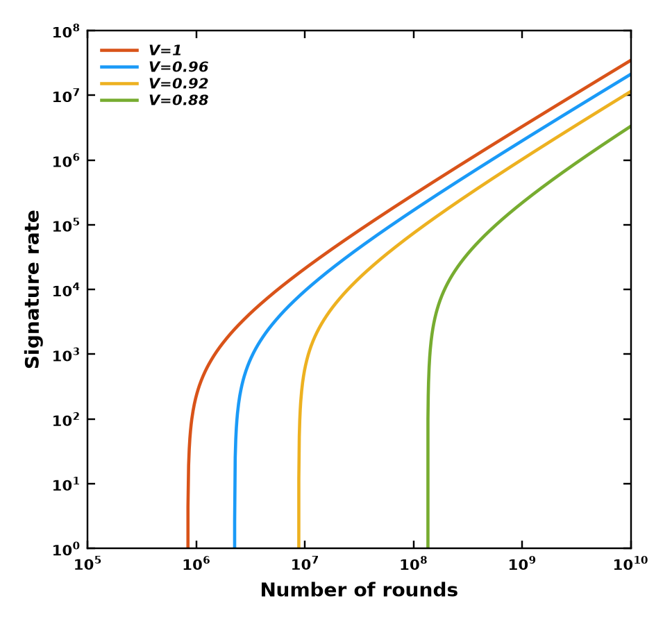
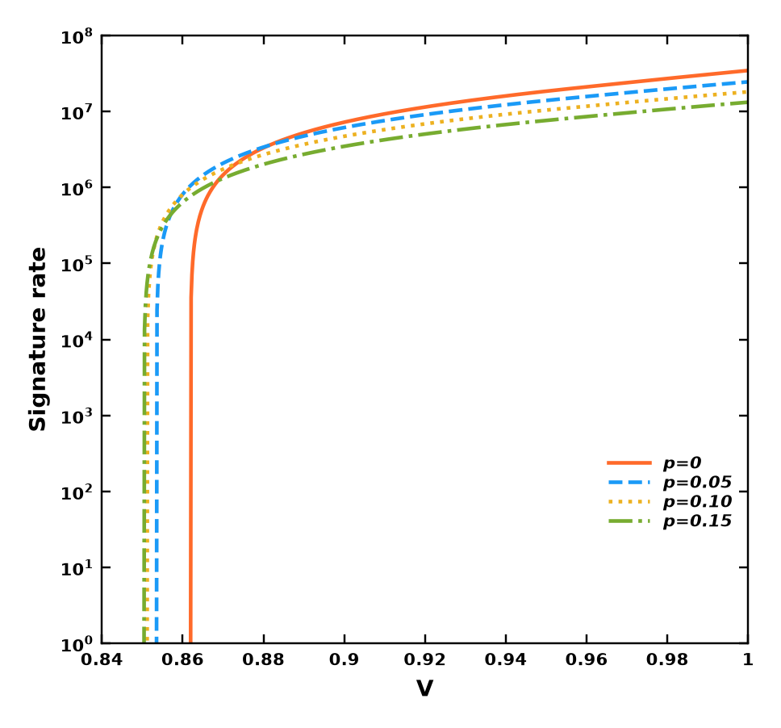
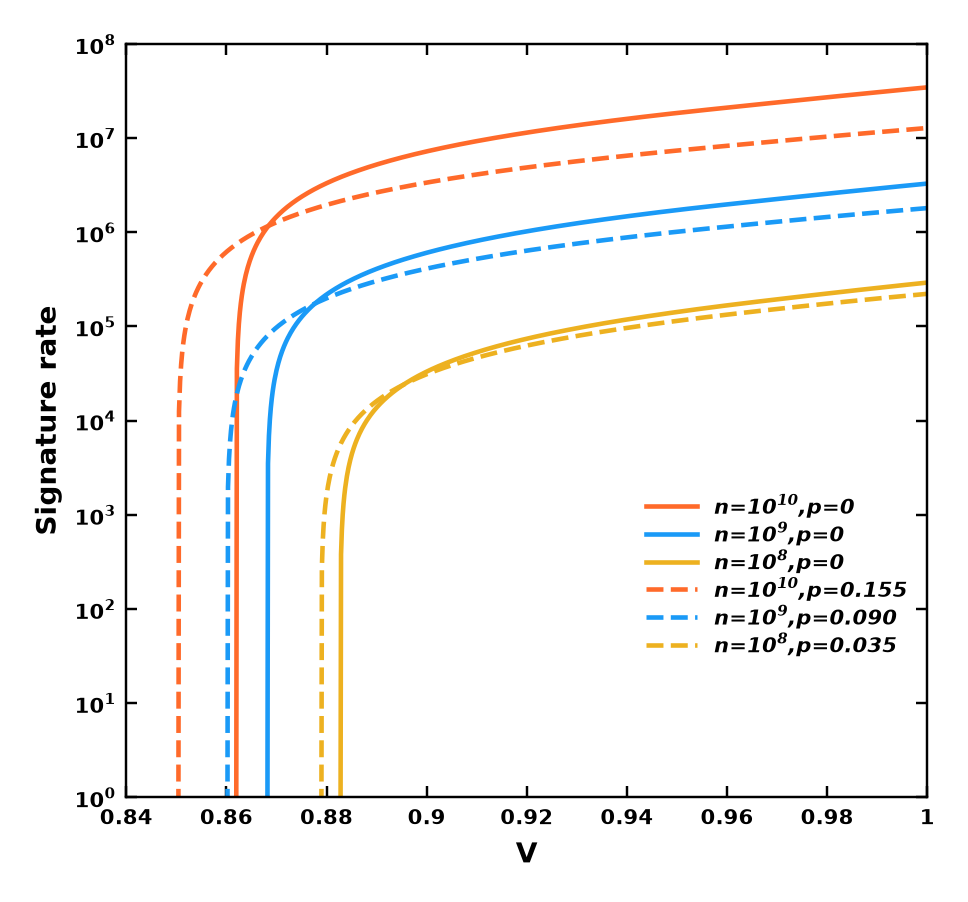
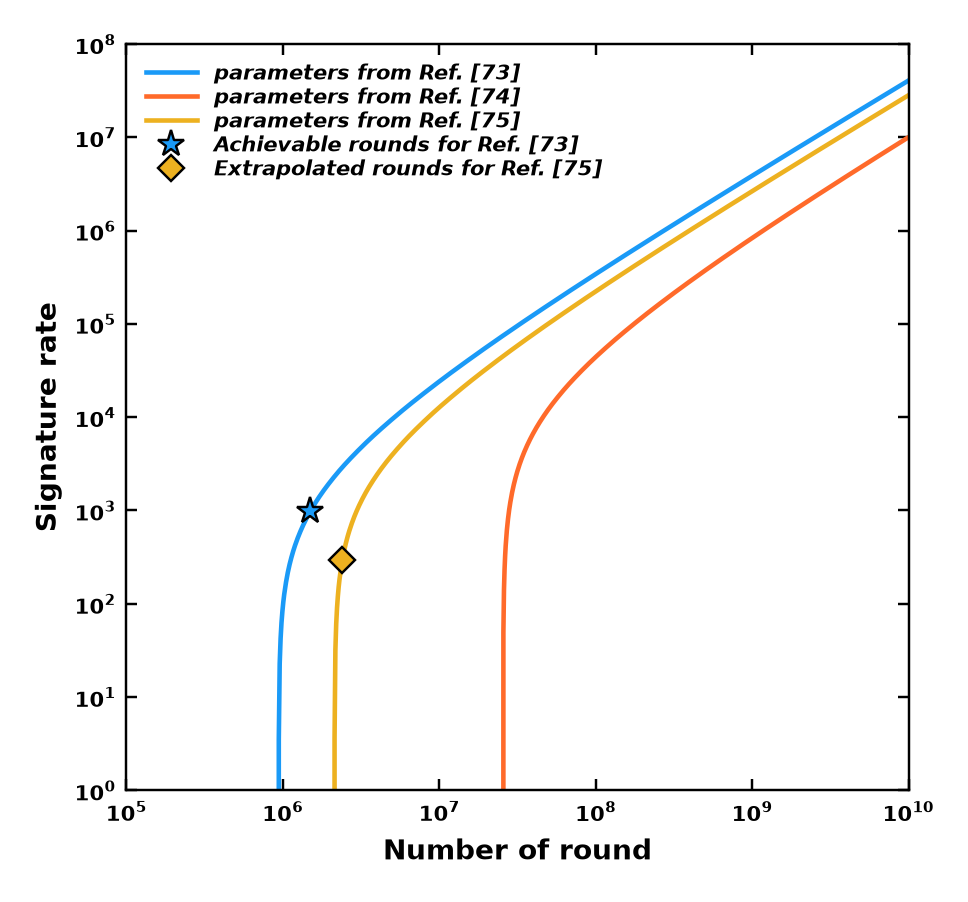
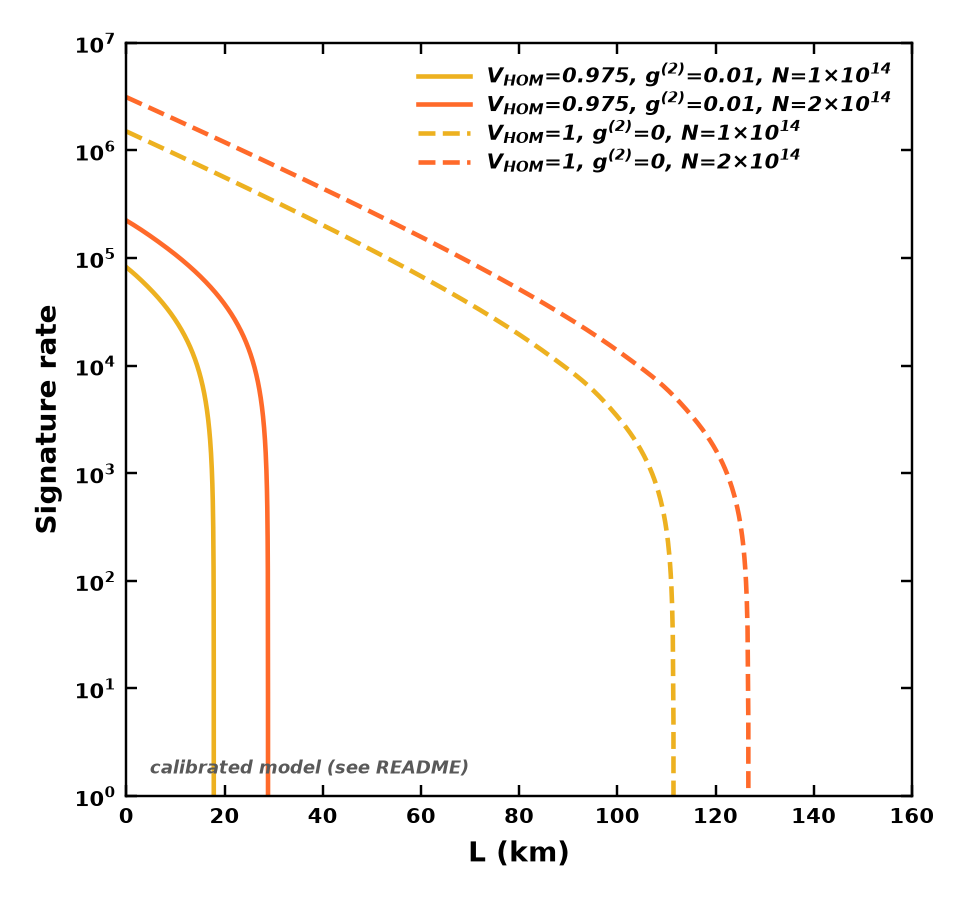

# QIQDS — device-independent quantum digital signatures (Python package `diqds`)

Python reimplementation of **Fan, Bian, Li, Wen, Yin, Chen, "Device-independent quantum digital signatures under
realistic conditions", Phys. Rev. A 114, 032617 (2026)**, with Qiskit for the quantum devices. The finite-size key
bound was reconstructed from its sources (Tan et al., Quantum 6, 880, arXiv:2012.08714; Ho et al., PRL 124, 230502,
arXiv:2005.13015) because the PDF's math is garbled, and then **checked against the numbers and the curves printed in
the paper**.

What you can do with it:

* run a complete signature system: Qiskit devices → device-independent keys → one-time signatures → forgery rejected;
* recompute the paper's thresholds, Figs. 3-7 and tables, and see how close they are to the printed ones;
* use the finite-size analysis from your own code (signature rate, minimum rounds, minimum visibility).

**Contents:** [1. Quick start](#1-quick-start-run-everything-from-scratch) · [2. Requirements and installation](#2-requirements-and-installation) ·
[3. Run every script](#3-run-every-script) · [4. Where the output goes](#4-where-the-output-goes) ·
[5. Troubleshooting](#5-troubleshooting) · [6. Use it from your own code](#6-use-it-from-your-own-code) ·
[7. Repository layout](#7-repository-layout) · [8. Reference: what is implemented and how well it matches](#8-reference-what-is-implemented-and-how-well-it-matches)

---

## 1. Quick start: run everything from scratch

```bash
git clone https://github.com/ksnganesh/QIQDS.git
cd QIQDS
python3 -m venv .venv
source .venv/bin/activate          # Windows PowerShell: .venv\Scripts\Activate.ps1    Windows cmd: .venv\Scripts\activate.bat
pip install -r requirements.txt
python scripts/run_all.py          # recomputes EVERYTHING from scratch: about 26 minutes on one core
```

`run_all.py` runs the 24 steps of [section 3](#3-run-every-script) in order (tests, demos, thresholds, **every curve of Figs. 3-7
recomputed**, the comparison with the paper, the tables, the slow regression tests) and ends with a table of which steps passed.
It does not take anything from stored results: see [what is recomputed](#what-is-recomputed-and-what-is-only-redrawn).
For a one-minute smoke test first, run `python -m pytest -q` and then `python scripts/demo_end_to_end.py`.

## 2. Requirements and installation

* **Python 3.10 or newer.** Everything in this file was run on Python 3.12 with qiskit 2.6.1, qiskit-aer 0.18.2,
  numpy 2.5, scipy 1.18, matplotlib 3.11 and pytest 9 (any recent Qiskit 1.x/2.x should work). If `pip install` fails on a
  very new Python release, create the environment with 3.12 or 3.13 (`python3.12 -m venv .venv`).
* No GPU and no internet after installation. The optimiser is single-threaded; one core is enough.
* `qiskit-aer` is needed only for `--backend aer` (the `demo-aer` step of `run_all.py` uses it; it is in `requirements.txt`);
  everything else works without it.

```bash
git clone https://github.com/ksnganesh/QIQDS.git
cd QIQDS
python3 -m venv .venv                 # Windows: py -m venv .venv
source .venv/bin/activate             # Windows PowerShell: .venv\Scripts\Activate.ps1    cmd: .venv\Scripts\activate.bat
pip install -r requirements.txt
python -c "import qiskit, qiskit_aer, numpy, scipy, matplotlib; print('qiskit', qiskit.__version__, '| aer', qiskit_aer.__version__)"
```

The last line should print something like `qiskit 2.6.1 | aer 0.18.2`. Optional: `pip install -e .` makes `import diqds`
work from any folder (see [section 6](#6-use-it-from-your-own-code)).

Rules for every command in this file:

* Run them from the **project folder** (the one that contains this README, `scripts/`, `diqds/` and `tests/`).
* Call tests as `python -m pytest`, never bare `pytest` (see [Troubleshooting](#5-troubleshooting)).
* Use `python3` (or `py` on Windows) if `python` is not found; use bash or zsh (not plain `sh`) for the `source` line.
* Times were measured on one single-core Linux VM; a modern laptop is usually similar or faster. The finite-size
  analysis is reproducible to the printed digits (the last digit can move with library versions); only the demo uses
  random numbers (seed 1 by default).

## 3. Run every script

### 3.1 One command: everything from scratch

```bash
python scripts/run_all.py                          # all 24 steps, from scratch (about 26 minutes)
python scripts/run_all.py --list                   # the steps, their commands and typical times
python scripts/run_all.py --dry-run                # print the commands without running them
python scripts/run_all.py --only tests demo        # a subset (names from --list)
python scripts/run_all.py --skip-slow              # leave out the 9 slow regression tests (about 3 minutes)
python scripts/run_all.py --quick                  # coarser plot grids (the plots are the longest part)
python scripts/run_all.py --resume                 # after an interruption: skip the steps that already passed
```

Each step's complete output is saved in `logs/NN_name.log` (use `tail -f logs/*_plot-fig4.log` to watch a long step; `logs/`
is not committed). The console shows one line per step, a `.` every 30 seconds while a step is running, and a summary at the end;
the exit status is 1 if any step failed, and the summary names the log to read.

Typical console output of a complete run (the timings are from one single-core machine; yours will differ):

```
24 steps, about 26 minutes on one core; logs in logs/ (a '.' every 30 s means the step is still running)

[ 1/24] tests          .ok  33 s
[ 2/24] demo           ok  5 s
[ 3/24] demo-aer       ok  7 s
[ 4/24] demo-standard  ok  3 s
[ 5/24] fig6-claims    .ok  33 s
[ 6/24] thresholds     ..ok  88 s
[ 7/24] plot-fig3      ..ok  83 s
[ 8/24] plot-fig4      ......ok  203 s
[ 9/24] plot-fig5      ........ok  246 s
[10/24] plot-fig6      .ok  57 s
[11/24] plot-fig7      .........ok  288 s
[12/24] figure-check   ok  1 s
[13/24] cmp-thr-1e8    ok  21 s
[14/24] cmp-thr-1e9    .ok  37 s
[15/24] cmp-thr-1e10   .ok  48 s
[16/24] cmp-fig4a      .ok  49 s
[17/24] cmp-fig4b      .ok  49 s
[18/24] cmp-fig3       .ok  42 s
[19/24] cmp-fig6       .ok  34 s
[20/24] cmp-misc       ok  9 s
[21/24] cmp-photonic   ok  8 s
[22/24] cmp-report     ok  1 s
[23/24] paper-tables   .ok  49 s
[24/24] slow-tests     .....ok  168 s

24 of 24 steps ok, 0 failed, 26.0 minutes
ALL STEPS PASSED. Results: results/*.json, results/curves/*.json, fig3_like.png ... fig7_like.png, COMPARISON.md, PAPER_TABLES.md
```

A from-scratch run reproduces the stored results exactly: after one, the nine `results/*.json` files, `COMPARISON.md` and `PAPER_TABLES.md`
were identical to the committed ones, and every curve had the same threshold (`git status` shows the files that changed).

#### What is recomputed, and what is only redrawn

| Command | Recomputes from scratch? |
|---|---|
| `python scripts/run_all.py` | **yes, everything** (it uses the forms marked "yes" below) |
| `python -m pytest -q`, `python -m pytest -q -m slow` | yes |
| `demo_end_to_end.py`, `reproduce_fig6_claims.py`, `reproduce_thresholds.py`, `reproduce_paper_tables.py` | yes |
| `compare_with_paper.py --part ...` (9 parts) | yes (each part overwrites its `results/*.json`) |
| `compare_with_paper.py --report` | no: it only assembles the `results/*.json` files into a table, so run all nine parts first |
| `plot_signature_rates.py --force` | **yes: every curve of the chosen figures is recomputed** |
| `plot_signature_rates.py` (no option) | only curves that are missing from `results/curves/`; stored ones are reused |
| `plot_signature_rates.py --replot` | **no: it only redraws the stored curves** (3 seconds) |
| `compare_figure_readings.py` | no: it compares the stored curves with numbers read off the paper, so run it after the plots |

The repository ships the stored curves and numbers, so `--replot` and `--report` work immediately; they are shortcuts for looking at
results. Everything that `run_all.py` does recomputes them.

### 3.2 The same, step by step

| # | What it does | Command | Recomputes? | Time |
|---|---|---|---|---|
| 1 | self-test (67 tests) | `python -m pytest -q` | yes | 35 s |
| 2 | whole signature system: quantum devices → keys → signatures | `python scripts/demo_end_to_end.py` | yes | 5 s |
| 3 | which published experiments are feasible (paper's Fig. 6) | `python scripts/reproduce_fig6_claims.py` | yes | 30 s |
| 4 | minimum-visibility thresholds vs the paper (Fig. 5) | `python scripts/reproduce_thresholds.py` | yes | 1.5 min |
| 5 | **the graphs** `fig3_like.png` … `fig7_like.png` (the paper's Figs. 3-7) | `python scripts/plot_signature_rates.py --force` (`--replot` only redraws) | yes | 15 min |
| 6 | numbers read off the printed figures vs the code | `python scripts/compare_figure_readings.py` (after Step 5) | no (compares) | 2 s |
| 7 | full side-by-side with the paper | `python scripts/compare_with_paper.py --part ...` (9 parts), then `--report` | yes, then assembles | 5 min |
| 8 | tables for the follow-up paper | `python scripts/reproduce_paper_tables.py` | yes | 1 min |
| 9 | regression tests against the paper's printed numbers | `python -m pytest -q -m slow` | yes | 3 min |

**Steps 1-6 are the core path (about 18 minutes from scratch). Steps 7-9 are deeper checks (about 9 minutes more).** Run in this
order: Step 6 reads the curves that Step 5 computes, and `--report` in Step 7 reads the numbers that the parts compute.
The section "Everything in order" below lists all commands in one block.

### Step 1 — Self-test

```bash
python -m pytest -q
```
```
................................................................         [100%]
67 passed, 9 deselected in 32.62s
```

All tests pass; the 9 "deselected" tests are the slow ones that Step 9 runs. **If you see fewer than 67 passed, Qiskit is not
visible to the Python that runs pytest** (the quantum and protocol test files are then skipped silently) — see
[Troubleshooting](#5-troubleshooting). If anything fails, fix it before going on.

### Step 2 — End-to-end signature system

```bash
python scripts/demo_end_to_end.py
```
```
security (Table I): eps=1e-10, eps_snd=5e-11, n_m=1000 -> n_s = 46 (138 key bits per signature and link)
plan: n=2,000,000  gamma=0.0586  p=0.0000  omega_thr=0.84664  EC_max=184,914  tag=61 bits  ->  ell=181,841 secret bits (0.0909 per round)

[Alice-Bob] ACCEPTED   (1.6s, backend=exact)
   test rounds 117,588  CHSH losses 17,683 <= 17,969   S_hat = 2.797   QBER(key) = 0.0051
   EC leakage 166,268 <= EC_max 184,914   verification hash ok = True
   secret key: 181,841 bits, Alice/partner copies equal = True

[Alice-Charlie] ACCEPTED   (1.5s, backend=exact)
   test rounds 117,240  CHSH losses 17,731 <= 17,969   S_hat = 2.790   QBER(key) = 0.0050
   EC leakage 165,469 <= EC_max 184,914   verification hash ok = True
   secret key: 181,841 bits, Alice/partner copies equal = True

signature capacity of this execution: 1317  (r_sig = ell/(3 n_s) = 1317.7)

-- messaging stage (Fig. 2)
   Transfer 100 EUR to Bob      Bob accepts: True   Charlie accepts: True
   Contract v2 - final          Bob accepts: True   Charlie accepts: True
   Bob forwards a modified document -> Charlie accepts: False   (forgery rejected)

-- sanity: devices without entanglement
    aborted: CHSH test failed: 29,606 losses > 17,969 allowed (S_hat = 1.984)
```

What happened, in order: (1) Eq. (9) was optimised for the expected devices and fixed the protocol parameters;
(2) Alice–Bob and Alice–Charlie each ran the 7-step device-independent key generation on their own Qiskit device pair
(the three checks — CHSH losses below the threshold, error-correction leakage within `EC_max`, verification hash — all passed);
(3) the two keys became 1317 one-time signature keys; (4) Bob and Charlie accepted honest signatures, and Charlie
rejected a document that Bob modified before forwarding; (5) unentangled devices were rejected by the CHSH test.
Your timings will differ; what matters is `ACCEPTED`, `True`, `forgery rejected`, and `aborted`.

Variations (each is a separate run; the output has the same format):

```bash
python scripts/demo_end_to_end.py --backend aer                      # CHSH circuits executed on qiskit-aer, ~7 s
python scripts/demo_end_to_end.py --variant standard --n 1000000     # the no-sifting protocol variant, ~3 s (1,638 signatures)
python scripts/demo_end_to_end.py --V 0.98 --n 3000000               # noisier devices need more rounds (2,181 signatures)
python scripts/demo_end_to_end.py --V 0.97 --n 5000000 --ec oracle   # see the note below (4,119 signatures)
```

Options: `--n` rounds per link, `--V` Werner-state visibility (device quality), `--backend exact|aer`,
`--ec cascade|oracle`, `--variant rkm|standard`, `--seed`. Two outcomes you may meet when you experiment; both are the
protocol working as designed, and the script then stops with exit status 1 and a one-line explanation:

* `no key at these parameters - increase --n or --V` (for example `--V 0.90 --n 1000000`): the finite-size bound is not
  positive, so nothing is run.
* `[Alice-Bob] ABORTED: error-correction budget exhausted ...` followed by `stopped: this link was aborted ...` (for example
  `--V 0.97 --n 5000000`): the real Cascade code is about 15 % above the Shannon limit and sends test-round bits raw, so below
  V ≈ 0.98 it overruns the paper's `EC_max` and the protocol correctly aborts. `--ec oracle` models the ideal code the
  paper assumes; with it that same run is accepted (568,493 secret bits).

### Step 3 — Which published experiments are feasible (Fig. 6)

```bash
python scripts/reproduce_fig6_claims.py        # takes no options
```
```
n_s = 46  (Table I)

Nadlinger et al., Nature 607, 682 (ions, 2 m)
   S=2.677, Q=0.0144, collected 1,500,000 rounds in 7.9 h
   paper: 1.5e6 rounds (~8 h) are within the acceptable range -> feasible
   [standard  ] n_min =       950,384  ->           5 h at the experiment's rate;  ell at collected n =    135,159  (feasible)
   [rkm_sifted] n_min =     2,460,758  ->          13 h at the experiment's rate;  ell at collected n =    -89,106  (not enough rounds)

Zhang et al., Nature 607, 687 (Rb atoms, 400 m)
   S=2.578, Q=0.0779, collected 3,342 rounds in 75 h
   paper: would need 'on the order of 1e7 hours' (3342 rounds per 75 h)
   [standard  ] n_min =    25,813,145  ->     579,290 h at the experiment's rate;  ell at collected n =    -16,207  (not enough rounds)
   [rkm_sifted] n_min =    52,688,782  ->   1,182,423 h at the experiment's rate;  ell at collected n =    -10,812  (not enough rounds)

Lu et al., Science 391, 592 (Rb atoms, 11 km)
   S=2.612, Q=0.0285, collected 1,208,000 rounds in 624 h
   paper: more than the collected 1.2e6 rounds needed; positive at 2.4e6 (~1248 h)
   [standard  ] n_min =     2,169,625  ->       1,121 h at the experiment's rate;  ell at collected n =   -114,842  (not enough rounds)
   [rkm_sifted] n_min =     5,539,598  ->       2,862 h at the experiment's rate;  ell at collected n =   -197,433  (not enough rounds)
```

How to read it: for each experiment, `n_min` is the number of rounds needed for a positive signature key, and the hours
column converts that at the experiment's own event rate. The `standard` lines match the paper's statements for
Nadlinger (feasible) and Lu (needs more than the 1.208×10⁶ collected, fewer than 2.4×10⁶). For Zhang the code gives
10⁵·⁸–10⁶·² hours against the paper's text "order 10⁷" — but the paper's own Fig. 6 starts that curve at about 2.2×10⁷
rounds, i.e. about 5×10⁵ hours, which agrees with the code (see [section 8](#8-reference-what-is-implemented-and-how-well-it-matches)).

### Step 4 — Fig. 5 thresholds vs the paper

```bash
python scripts/reproduce_thresholds.py
```
```
variant = rkm_sifted  (key_weight=0.5, EC model=sifted)
       n |  V_min p=0   paper    diff | V_min p opt   paper    diff
   1e+08 |     0.8828  0.8835 -0.0007 |      0.8788  0.8799 -0.0011   [16s]
   1e+09 |     0.8681  0.8686 -0.0005 |      0.8602  0.8608 -0.0006   [30s]
   1e+10 |     0.8618  0.8622 -0.0004 |      0.8504  0.8508 -0.0004   [40s]
```

`V_min` is the smallest device visibility that still yields a signature; "p opt" uses optimised noisy preprocessing.
All six values agree with the paper to about 10⁻³. The last digit can differ by ±1 from the tables below because this
default run uses a coarser bisection tolerance. Options: `--only 1e9` (one row), `--skip-np` (skip the optimised-p column;
`--only 1e8 --skip-np` takes 3 s), `--tol 5e-5` (finer, several minutes), and `--variant standard`, which runs the no-sifting
reading: it gives V_min = 0.8755 at n = 10⁸ against the paper's 0.8835, i.e. it does *not* reproduce Fig. 5 (that figure
belongs to the sifted reading; the standard reading is the one that matches Fig. 6, Step 3).

### Step 5 — The graphs (the paper's Figs. 3-7)

```bash
python scripts/plot_signature_rates.py --force                 # recompute every curve of all five figures from scratch (about 15 min), then draw them
python scripts/plot_signature_rates.py --which fig4 --force    # only one figure: fig3 | fig4 | fig5 | fig6 | fig7
python scripts/plot_signature_rates.py --replot                # optional shortcut: redraw from the stored curves, computes nothing (3 s)
```
Output of `--which fig3 --force` (one line per recomputed curve, with its time):

```
[fig3]
  computed fig3_V1_p0_rkm  [16 s]
  computed fig3_V0.96_p0_rkm  [15 s]
  computed fig3_V0.92_p0_rkm  [18 s]
  computed fig3_V0.88_p0_rkm  [33 s]
done
```

and of `--which fig7 --force`:

```
[fig7]
  computed fig7_calibration  [37 s]
  computed fig7_ideal_chain  [20 s]
  computed fig7_real_N1e14  [116 s]
  computed fig7_real_N2e14  [114 s]
  calibration: V_eff(ideal) = 0.9187; realistic V0 = 0.8641, c = 2.82e-03
  ideal N=1e+14: cutoff 111.46 km (paper 111.46), rate at L = 0: 1.51e+06
  ideal N=2e+14: cutoff 126.71 km (paper 126.53), rate at L = 0: 3.13e+06
  real  N=1e+14: cutoff 17.82 km (paper 17.82), rate at L = 0: 8.22e+04
  real  N=2e+14: cutoff 28.87 km (paper 28.87), rate at L = 0: 2.23e+05
done
```

The graphs are written as PNG files into the project folder (no window pops up). Open them with your image viewer or:
`open fig3_like.png` (macOS), `start fig3_like.png` (Windows), `xdg-open fig3_like.png` (Linux).

How it works: every computed curve is stored in `results/curves/*.json` (these files are in the repository, which is what makes
`--replot` instant). With `--force` each curve is recomputed and its stored file overwritten, and one line per finished curve is
printed (`computed fig3_V1_p0_rkm  [16 s]`; Fig. 3 takes about 1.5 minutes, Fig. 4 3.5, Fig. 5 4, Fig. 6 1, Fig. 7 5). Without
`--force`, stored curves are reused and only missing ones are computed; `--replot` never computes (and stops with a message if a stored
curve is missing). The other options: `--quick` uses a coarser grid, `--out DIR` writes the PNGs elsewhere, `--which both` draws
Fig. 3 and Fig. 5 (the old default), `--no-note` removes the "calibrated model" note from Fig. 7. An interrupted run resumes
where it stopped when you leave out `--force`.

All settings are the ones printed in the paper's figures (legends and axes read from the PDF):

| Figure | What it shows | Settings (from the paper) | Results |
|---|---|---|---|
| **Fig. 3** `fig3_like.png` | signature rate vs number of rounds n | V = 1, 0.96, 0.92, 0.88; p = 0; n = 10⁵…10¹⁰ | n_min = 8.4×10⁵, 2.3×10⁶, 8.8×10⁶, 1.4×10⁸, then linear growth in n |
| **Fig. 4** `fig4_like.png` | signature rate vs V at n = 10¹⁰ | p = 0, 0.05, 0.10, 0.15 | threshold 0.862 → 0.853, 0.851, 0.850; lower rate at high V |
| **Fig. 5** `fig5_like.png` | signature rate vs V for three n | n = 10⁸, 10⁹, 10¹⁰; solid p = 0, dashed p = 0.035, 0.090, 0.155 (fixed, from the legend) | V_min 0.8827 / 0.8681 / 0.8619 (solid), 0.8789 / 0.8601 / 0.8503 (dashed) |
| **Fig. 6** `fig6_like.png` | signature rate vs n for three experiments | (S, Q) of Refs. [73]-[75], standard protocol; star n = 1.5×10⁶, diamond n = 2.4×10⁶ | n_min = 9.4×10⁵ ([73]), 2.6×10⁷ ([74]), 2.1×10⁶ ([75]) |
| **Fig. 7** `fig7_like.png` | signature rate vs distance (all-photonic scheme) | T = 0.01, L₀ = 22 km, η_conv = 0.5, V_HOM = 1 / 0.975, g⁽²⁾ = 0 / 0.01, N = 10¹⁴, 2×10¹⁴ | **calibrated model, not a prediction**, see below |







Two details that matter when you compare with the paper: in Fig. 5 the dashed curves use the legend's **fixed** p (the p that
minimises V_min), not a p re-optimised at every V — that is why each dashed curve starts at lower V than its solid partner but
ends below it at high V. And **Fig. 7 is not an independent reproduction**: the paper does not give the heralding probability or
the heralded state, so the figure uses P_H = 0.3·[2T(1−T)]²·η_C²/2 with a Werner state of effective visibility 0.919 (ideal
source) or 0.864 − 2.8×10⁻³(e^{L/2L₀} − 1) (realistic source); the three constants were fitted to the printed curves and the quoted
cutoffs, and the plot says so in its corner (see [section 8](#8-reference-what-is-implemented-and-how-well-it-matches)).

### Step 6 — How close are the graphs to the printed ones?

```bash
python scripts/compare_figure_readings.py      # run it after Step 5: it reads the curves that Step 5 stored
```

It compares the stored curves with numbers I read off the printed Figs. 3-7 (a 300-dpi render of the PDF; accuracy about
2×10⁻⁴ in V and 1-2 % in rate) and prints one markdown table per figure (about 100 rows: code, paper, code/paper) followed by
a summary:

```
**Median |code/paper - 1| per figure** (readings of rate/threshold quantities only)

- fig3: 2.4 %  (max 6.3 %, 18 readings)
- fig4: 0.8 %  (max 2.3 %, 16 readings)
- fig5: 1.1 %  (max 2.4 %, 20 readings)
- fig6: 7.4 %  (max 18.1 %, 17 readings)
- fig7: 6.7 %  (max 31.0 %, 30 readings)
```

Figs. 3-5 agree to about 1-2 %. Fig. 6 agrees to 2-8 % in the asymptotic rates but needs 6-18 % more rounds near the threshold
(the curves are steep there). Fig. 7 is fitted (see above), so its agreement is a fit, not a test, except for the second ideal
cutoff (126.71 km vs 126.53 km printed) and the realistic curves at 1-25 km (within about 20 %).

### Step 7 — Full side-by-side with the paper (optional)

`scripts/compare_with_paper.py` recomputes the paper's results part by part and stores them in `results/*.json`.
`--report` then assembles them into one table (`COMPARISON.md`), so run all nine parts first (in any order):

```bash
python scripts/compare_with_paper.py --part thresholds --n 1e8     # ~20 s   Fig. 5, row n = 1e8
python scripts/compare_with_paper.py --part thresholds --n 1e9     # ~35 s   Fig. 5, row n = 1e9
python scripts/compare_with_paper.py --part thresholds --n 1e10    # ~50 s   Fig. 5, row n = 1e10
python scripts/compare_with_paper.py --part fig4a                  # ~50 s   Fig. 4: threshold for fixed p, n = 1e10
python scripts/compare_with_paper.py --part fig4b                  # ~50 s   Fig. 4: signature rate for fixed p
python scripts/compare_with_paper.py --part fig3                   # ~35 s   Fig. 3: n_min and growth slope
python scripts/compare_with_paper.py --part fig6                   # ~35 s   Fig. 6: the three experiments
python scripts/compare_with_paper.py --part misc                   # ~10 s   Table I, message length, completeness
python scripts/compare_with_paper.py --part photonic               # ~10 s   Fig. 7 consistency estimate (not a reproduction)
python scripts/compare_with_paper.py --report                      # ~1 s    prints the assembled table
```

Typical single-line outputs:

```
n=1e+08: V_min(p=0)=0.8827 (paper 0.8835)  V_min(p opt)=0.8788 (paper 0.8799)  [21s]
n=1e+09: V_min(p=0)=0.8681 (paper 0.8686)  V_min(p opt)=0.8601 (paper 0.8608)  [35s]
n=1e+10: V_min(p=0)=0.8619 (paper 0.8622)  V_min(p opt)=0.8503 (paper 0.8508)  [47s]
```
```
fixed p=0.02: V_min(n=1e10) = 0.8565  [18s]
fixed p=0.05: V_min(n=1e10) = 0.8534  [17s]
fixed p=0.1: V_min(n=1e10) = 0.8511  [13s]
```
```
V=1.0: n_min = 8.43e+05, log-log slope r_sig(1e10 -> 1e11) = 1.010
V=0.96: n_min = 2.29e+06, log-log slope r_sig(1e10 -> 1e11) = 1.012
V=0.92: n_min = 8.82e+06, log-log slope r_sig(1e10 -> 1e11) = 1.020
V=0.88: n_min = 1.38e+08, log-log slope r_sig(1e10 -> 1e11) = 1.060
```

`--part fig4b` prints 20 lines (4 visibilities × 5 noisy-preprocessing settings), `--part fig6` six lines, and `--part misc`
and `--part photonic` print JSON. The repository already contains a complete, consistent set of results, so
`python scripts/compare_with_paper.py --report` works immediately; the parts above refresh them. The report starts like this:

```
# This implementation vs. Fan et al., Phys. Rev. A 114, 032617 (2026)

Generated by `scripts/compare_with_paper.py --report` from the cached results in `results/`.

## 1. Depolarizing noise (Figs. 3-5)

| Paper result | Paper | This code | Verdict |
|---|---|---|---|
| V_min, n = 1e+08, p = 0 (Fig. 5) | 0.8835 | 0.8827 | match (Δ = -0.0008) |
```

To save the report as a file: `python scripts/compare_with_paper.py --report > COMPARISON.md` (on Windows add `-X utf8`:
`python -X utf8 scripts/compare_with_paper.py --report > COMPARISON.md`). The checked-in `COMPARISON.md` is exactly this output.

### Step 8 — Tables for the follow-up paper (optional)

```bash
python scripts/reproduce_paper_tables.py                       # prints the tables, ~1 min
python scripts/reproduce_paper_tables.py > PAPER_TABLES.md     # same, saved to a file
```
```
## Sec. 3.2  signature layer: n_s from Eq. (4)  (eps = 1e-10, n_m = 1000)

| eps_snd | n_s (code) | paper | 3 n_s |
|---|---|---|---|
| 1.0e-11 | 45 | 45 | 135 |
| 5.0e-11 | 46 | 46 | 138 |
| 9.0e-11 | 48 | 48 | 144 |
| 9.9e-11 | 51 | 51 | 153 |
```

It prints seven sections: n_s from Eq. (4), Table 3 (private random bits per round), the randomness ledger at the optimiser's own
(γ, p), Table 2 (threshold visibilities), the 11 km operating point, the budget split between key layer and hashing layer, and where
the finite-size penalty sits. The checked-in `PAPER_TABLES.md` is exactly this output. See
[`CHANGES_FOR_YOUR_PAPER.md`](CHANGES_FOR_YOUR_PAPER.md) for what these tables mean for the follow-up paper. (The optional
`--tightened FILE.json` argument takes the result of the Rényi convex program, which is not part of this package.)

### Step 9 — Regression tests against the paper's printed numbers (optional)

```bash
python -m pytest -q -m slow
```
```
.........                                                                [100%]
9 passed, 67 deselected in 168.62s (0:02:48)
```

These nine tests recompute the Fig. 5 thresholds (three without and three with noisy preprocessing), the Fig. 6 statements
(Nadlinger and Lu), and two follow-up-paper checks (the structure of the budget-split scan, and how the definition of the
minimum key length shifts the threshold), and fail if the code drifts away from the paper's numbers. To run only some of them, add `-k`, for example
`python -m pytest -q -m slow tests/test_finite_key.py -k fig6`.

### Everything in order (copy-paste)

`python scripts/run_all.py` does all of this, from scratch, with a log per step. The same commands one by one:

```bash
python -m pytest -q                                                    # Step 1
python scripts/demo_end_to_end.py                                      # Step 2
python scripts/demo_end_to_end.py --backend aer
python scripts/demo_end_to_end.py --variant standard --n 1000000
python scripts/reproduce_fig6_claims.py                                # Step 3
python scripts/reproduce_thresholds.py                                 # Step 4
python scripts/plot_signature_rates.py --force                         # Step 5: recomputes all five figures (about 15 min)
python scripts/compare_figure_readings.py                              # Step 6 (after Step 5)
python scripts/compare_with_paper.py --part thresholds --n 1e8         # Step 7: the nine parts, then the report
python scripts/compare_with_paper.py --part thresholds --n 1e9
python scripts/compare_with_paper.py --part thresholds --n 1e10
python scripts/compare_with_paper.py --part fig4a
python scripts/compare_with_paper.py --part fig4b
python scripts/compare_with_paper.py --part fig3
python scripts/compare_with_paper.py --part fig6
python scripts/compare_with_paper.py --part misc
python scripts/compare_with_paper.py --part photonic
python -X utf8 scripts/compare_with_paper.py --report > COMPARISON.md
python -X utf8 scripts/reproduce_paper_tables.py > PAPER_TABLES.md     # Step 8
python -m pytest -q -m slow                                            # Step 9
```

Total: about 26 minutes. Every command prints its result to the screen (or, where shown, into the named file); nothing else is
changed except the files listed in the next section.

---

## 4. Where the output goes

| File | Written by | What it is |
|---|---|---|
| `fig3_like.png` … `fig7_like.png` | Step 5 (`plot_signature_rates.py`) | the graphs; project folder, or `--out DIR` |
| `results/curves/*.json` | Step 5 | every computed curve (cache; `--force` recomputes) |
| `results/*.json` | Step 7 (`compare_with_paper.py --part ...`) | cached numbers that `--report` reads |
| `COMPARISON.md` | `run_all.py`, or `--report > COMPARISON.md` | side-by-side table with the paper |
| `PAPER_TABLES.md` | `run_all.py`, or `reproduce_paper_tables.py > PAPER_TABLES.md` | tables for the follow-up paper |
| `logs/NN_name.log` | `run_all.py` | the complete output of every step (not committed) |

Everything else (demo, thresholds, Fig. 6, tests, `compare_figure_readings.py`) prints to the screen only. Because the result files are
committed, `git status` after a from-scratch run shows which ones changed; differences in the last digit are normal.

## 5. Troubleshooting

* **`run_all.py` stops at once with a message** (`cannot find the project folder`, `missing files: ...`, `Python packages are
  missing ...`): do what the message says. Run it from inside the project folder (the file may sit in `scripts/` or in the project folder
  itself; it finds the project either way); unzip the update zip over the project (or `git pull`); activate the virtual environment and run
  `python -m pip install -r requirements.txt`. These checks happen before any step starts, so nothing is half-run.
* **A `run_all.py` step shows `FAILED`:** open the log it names (`logs/NN_name.log`), fix the cause, and run
  `python scripts/run_all.py --resume`, which skips the steps that already passed. To rerun one step: `python scripts/run_all.py --only NAME`.
* **How do I know nothing was taken from stored results?** The plot logs (`logs/*_plot-fig*.log`) contain one `computed ... [N s]`
  line per curve; a reused curve would print nothing. The comparison parts print their own timings (`[21s]`, ...).
* **`source: not found`:** you are in plain `sh`. Start `bash` (or `zsh`) first, or use `. .venv/bin/activate`. On Windows
  PowerShell, if activation is blocked ("running scripts is disabled"), run
  `Set-ExecutionPolicy -Scope Process RemoteSigned` once in that window, or use `.venv\Scripts\activate.bat` in cmd.
* **`python: command not found`:** use `python3` (macOS/Linux) or `py` (Windows).
* **`No module named 'qiskit'` from `pytest`, but `python scripts/...` works:** a global `pytest` is shadowing the one in your
  virtual environment. Always use `python -m pytest`. Without `-q` the run prints a header line `python used by pytest: ...`
  (and a warning if Qiskit cannot be imported), which shows which interpreter is in use.
* **`No module named 'diqds'`:** you are not in the project folder (the tests need to be started from there; the scripts find
  the package themselves), or you are running your own script from another folder. `cd` into the folder that contains
  `diqds/`, `scripts/` and `tests/`, or run `pip install -e .` once (inside the virtual environment) to make `diqds` importable from anywhere.
* **`qiskit_aer` fails to install:** only `--backend aer` needs it. Everything else works with the default `exact` back end
  (remove that line from `requirements.txt`, or ignore the error).
* **`--replot: no cached curve '...'`:** a stored curve is missing from `results/curves/`. Run the same command without
  `--replot` (it computes only what is missing).
* **The plot script prints nothing for a minute:** it is computing. It prints one line per finished curve; Fig. 4 and Fig. 7 take
  the longest. `Ctrl+C` is safe: finished curves are kept and the next run resumes.
* **No window opens for the graphs:** by design; the plots are saved as PNG files (see Step 5).
* **Font warnings from matplotlib:** harmless and silenced; the plots use Arial if it is installed, otherwise Liberation Sans or DejaVu Sans.
* **`UnicodeEncodeError` when redirecting output to a file on Windows:** run Python with UTF-8 mode, e.g.
  `python -X utf8 scripts/compare_with_paper.py --report > COMPARISON.md`.
* **A step takes much longer than listed:** the optimiser is single-threaded, so a slower or busy machine scales every time
  linearly. Use the shorter forms: `reproduce_thresholds.py --skip-np`, `--only 1e9`, or `--which fig3` for one graph.
* **Numbers differ from this file in the last digit:** library versions (NumPy/SciPy) move the optimiser by about 10⁻⁴ in V or a
  fraction of a percent in rates. The comparisons with the paper hold to ~10⁻³ in V.
* **`ABORTED` or `no key at these parameters` in the demo:** that is the protocol working as designed, see Step 2.

Repository hygiene (optional): the repository contains committed `__pycache__/*.pyc` files. Add the supplied `.gitignore` and
untrack them with `git rm -r -q --cached $(git ls-files | grep -E '__pycache__|\.pyc$')`, then commit.

## 6. Use it from your own code

Run Python from the project folder, or run `pip install -e .` once to import `diqds` from anywhere.

```python
import numpy as np
from diqds.presets import RKM_SIFTED
from diqds.experiments import signature_rate_werner, minimum_rounds
from diqds.finite_key import werner_S_Q, min_visibility, SecurityBudget
from diqds.diqkd import plan_distribution, run_diqkd
from diqds.quantum import CHSHSource

# signature rate of the paper's protocol for Werner-state devices of visibility V = 0.95 and n = 1e9 rounds
signature_rate_werner(10**9, 0.95, RKM_SIFTED)
# {'n': 1000000000, 'ell': 237725896.9, 'n_s': 46, 'r_sig': 1722651.4, 'gamma': 0.0079, 'p': 0.0, 't': ..., 'omega_thr': ..., 'ec_max': ...}

S, Q = werner_S_Q(0.95)                                    # CHSH value and bit-error rate of that state
minimum_rounds(S, Q, RKM_SIFTED, p=0.0)                    # 3.04e6 rounds for a positive signature key
min_visibility(10**9, p=0.0, key_weight=0.5, ec_model="sifted")   # 0.8681 (smallest V with a key at n = 1e9)

# run the device-independent key generation itself on Qiskit devices
V = 0.99
S, Q = 2 * np.sqrt(2) * V, (1 - V) / 2
plan = plan_distribution(2_000_000, S, Q, RKM_SIFTED, budget=SecurityBudget(eps_snd=5e-11))
res = run_diqkd(plan, CHSHSource(V, "exact"), np.random.default_rng(1))
print(res.accepted, len(res.key_alice))                    # True 181841
```

With noisy preprocessing optimised, prefer `maximize_key_length_over_p` / `min_visibility_over_p` from `diqds.finite_key`
over `p=None` (see "Not reproduced / limits"); they search p in an outer loop and are about 12 times slower
(`min_visibility_over_p(10**9, key_weight=0.5, ec_model="sifted", tol=1e-4)` gives 0.8601 in about 2 minutes).
`scripts/demo_end_to_end.py` shows the whole signing and verification stage (`diqds.messaging`).

## 7. Repository layout

```
QIQDS/
├── README.md  COMPARISON.md  PAPER_TABLES.md  CHANGES_FOR_YOUR_PAPER.md  LICENSE (MIT)
├── requirements.txt  pyproject.toml  pytest.ini  conftest.py
├── diqds/            the package: diqkd, finite_key, quantum, error_correction, messaging, hashing, gf2,
│                     security, experiments, presets, photonic, randomness, renyi_bound
├── scripts/          the runnable programs of section 3 (run_all.py runs them all)
├── tests/            76 tests (67 fast, 9 slow)
├── results/          cached numbers (*.json) and cached curves (curves/*.json)
└── fig3_like.png … fig7_like.png
```

---

## 8. Reference: what is implemented and how well it matches

### Map of the paper to the code

| Paper | Module | Notes |
|---|---|---|
| Sec. II.A steps 1-7 (acquisition, sifting, noisy preprocessing, EC, parameter estimation, PA) | `diqkd.py` | `plan_distribution()` fixes parameters from Eq. (9); `run_diqkd()` executes the protocol |
| Honest devices, Werner state, CHSH measurements (Sec. IV) | `quantum.py` | **Qiskit**: `QuantumCircuit` (H, CX, Ry, measure), `DensityMatrix`, `AerSimulator` + depolarizing noise model |
| Eq. (9), (B1)-(B12) | `finite_key.py` | entropy-accumulation key length + optimiser over γ, t, α, α′, β, ε-split, p; `maximize_key_length_over_p` searches p in an outer loop |
| Error correction (step 5) | `error_correction.py` | real **Cascade** (all revealed parities counted against EC_max) or an oracle |
| Sec. II.B, Fig. 2, App. A | `messaging.py`, `hashing.py`, `gf2.py` | sign / verify / certify, LFSR-Toeplitz hash (matrix and fast forms cross-checked), GF(2)[x] arithmetic |
| Eqs. (4)-(8), Table I | `security.py` | n_s = 46 from Table I; r_sig = ℓ/(3 n_s) |
| Figs. 3-7 | `experiments.py`, `presets.py`, `scripts/` | signature rates, minimum rounds, Fig. 6 report; plots of Figs. 3-7 (Fig. 7 calibrated) |
| Follow-up paper: Eq. (5), Table 3 | `randomness.py` (+ ledger inside `diqkd.run_diqkd`) | randomness ledger, supply check |
| Follow-up paper: Eq. (2) | `renyi_bound.py` | **scaffold only** (needs the Rényi convex program) |
| App. C/D | `photonic.py` | HOM visibility, heralded state (D1), channel (D2); `heralding_probability` is a calibrated model, so Fig. 7 is **not** a prediction |

Qiskit is used for everything that is actually quantum (state, measurements, noise, sampling). The finite-size
bounds are classical numerics (NumPy/SciPy), as in the paper.

### Validation against the paper

**Fig. 5: minimum Werner visibility for a positive signature** (`scripts/reproduce_thresholds.py --tol 5e-5`, protocol variant `RKM_SIFTED`)

| n | V_min, p = 0 (this code / paper) | V_min, optimised p (this code / paper) |
|---|---|---|
| 10⁸  | 0.8827 / 0.8835 | 0.8788 / 0.8799 |
| 10⁹  | 0.8681 / 0.8686 | 0.8601 / 0.8608 |
| 10¹⁰ | 0.8619 / 0.8622 | 0.8503 / 0.8508 |

Largest deviation 1.1×10⁻³ (all slightly on the optimistic side, plausibly a less-converged optimiser in the paper).
The size of the noisy-preprocessing gain matches as well.

**Fig. 6: matter-qubit experiments** (`scripts/reproduce_fig6_claims.py`, protocol variant `STANDARD`; parameters read from the experiment papers)

| Experiment | Paper's statement | This code |
|---|---|---|
| Nadlinger et al. [73], S = 2.677, Q = 1.44 % | 1.5×10⁶ rounds feasible | n_min = 9.5×10⁵; ℓ = 135k bits at 1.5×10⁶ ✓ |
| Lu et al. [75], 11 km, S = 2.612, Q = 2.85 % | needs more than the 1.208×10⁶ collected rounds, positive by 2.4×10⁶ | n_min = 2.17×10⁶ ✓ |
| Zhang et al. [74], S = 2.578, Q = 7.79 % | text: "order of 10⁷ hours" | 5.8×10⁵ h (standard) / 1.2×10⁶ h (RKM). The paper's own Fig. 6 starts this curve at ~2.2×10⁷ rounds, i.e. ~5×10⁵ h at 44.6 rounds/h: **the figure agrees with the code, the sentence in the text does not** |

**Curve by curve against the printed figures** (`scripts/compare_figure_readings.py`, Step 6): median deviation 2.4 % (Fig. 3),
0.8 % (Fig. 4), 1.1 % (Fig. 5), 7.4 % (Fig. 6), 6.7 % (Fig. 7, fitted). Figs. 3 and 4 were not used when the protocol reading was chosen,
so they test the curve shapes independently.

Also reproduced: n_s = 46 and 138 key bits per signature from Table I; "≈370 h for 10¹⁴ rounds at 75 MHz";
S = 2√2·V and Q = (1−V)/2 from the Qiskit circuits (exact and Aer); Eq. (A12) (multiples of p(x) hash to 0);
the 2⁻ⁿˢ random-forgery rate; Eq. (C8) → (C7) as σ → 0.

**What to change for the follow-up paper (Rényi bound, budget split, randomness ledger): [`CHANGES_FOR_YOUR_PAPER.md`](CHANGES_FOR_YOUR_PAPER.md), tables in [`PAPER_TABLES.md`](PAPER_TABLES.md).**

**Full side-by-side comparison: [`COMPARISON.md`](COMPARISON.md)** (regenerate the numbers part by part with
`scripts/compare_with_paper.py --part ...`, Step 7). Caveat: the protocol reading was chosen by comparing with Figs. 5 and 6, so
those two matches are calibrations, not blind predictions; the Fig. 4/3 behaviour, completeness, message-length
insensitivity and the ΔL scaling of Fig. 7 were not tuned.

### What reverse-engineering found in the paper

1. **Eqs. (B1) and (B11) do not belong together.** (B1) halves the key-round entropy (sifting) but (B11) as printed
   charges the full EC cost with no sifting factor and no dependence on p. Taken literally they give V_min ≈ 0.91 at
   n = 10¹⁰ (paper: 0.862). The reading that reproduces Figs. 3-5 puts the same ½ factor in the EC term and uses
   Q′ = p + (1−2p)Q (`ec_model="sifted"`, Tan et al. Eq. 26). Fig. 6 instead matches the *no-sifting* protocol of
   Ref. [73] with (B11) as printed. These are the two presets `RKM_SIFTED` and `STANDARD`. If EC ignores p, noisy
   preprocessing becomes a free lunch (positive key at V = 0.80), so the paper cannot have done that.
2. The text calls r_p "an affine function of ω". It is a nonlinear convex function; the affine min-tradeoff function is
   its tangent g_t (convexity checked numerically, so the tangent is a valid lower bound).
3. ε bookkeeping: Tan et al. give soundness max{ε_EA, ε_PA+2ε_s} + 2ε_h; the paper's wording suggests +3ε_h. The
   difference is negligible. The paper's robustness bound uses ε_corr ≤ 2⁻⁶¹, so ε_h defaults to 2⁻⁶¹ (61-bit tag).
4. The polynomial-generation function f of Ref. [32] is not given. `gf2.irreducible_from_key` is a documented
   stand-in (first irreducible polynomial at or after x^n + Z); its output is not exactly uniform over irreducibles.
5. In the messaging stage as described, Bob's own X_b and Z_b are never used in verification.
6. Eq. (D1) prints the amplitude ratio √(t/(1−t)); the cited model paper (Gonzalez-Ruiz et al., Eq. 1) and a
   beam-splitter derivation give t/(1−t). They agree at t = 1/2, the only value the paper simulates
   (`photonic.heralded_state(t, convention="printed" | "derived")`).
7. The paper's text and its own Fig. 6 disagree about Ref. [74] (see the table above).

### Not reproduced / limits

* **Fig. 7 (photonic distance curves) is calibrated, not predicted.** The paper does not give the heralding probability or the
  map from (V_HOM, g⁽²⁾, η_l, T, t) to the heralded state; the probability table is in the supplement of Ref. [80].
  `fig7_like.png` therefore uses a model with fitted constants: P_H = 0.3·[2T(1−T)]²·η_C²/2 (the factor 0.3 fitted to the
  printed ideal curves; the naive count, 1, is a factor ~2 too high), a Werner state of effective visibility 0.919 for the ideal
  source (fitted to the 111.46 km cutoff) and 0.864 − 2.8×10⁻³(e^{L/2L₀} − 1) for the realistic one (fitted to the 17.82 and 28.87 km
  cutoffs). What is predicted rather than fitted: the second ideal cutoff (126.71 km vs 126.53 km printed) and the realistic
  curves at 1-25 km (within ~20 % of the print). A first-principles estimate (η_l only) overshoots the ideal-source distances
  by 45-66 km, i.e. the paper's model contains noise its text does not specify (COMPARISON.md §3). With the authors' actual model
  (or their code) replace `diqds.photonic.heralding_probability` and the effective-visibility fits in `fig7_data`.
* **`maximize_key_length(..., p=None)` can stall in the p ≈ 0 basin** when it is warm-started (e.g. inside the bisection of
  `min_visibility`): V_min came out 0.8699 at n = 6.5×10⁸ but 0.8601 at n = 10⁹. `maximize_key_length_over_p` /
  `min_visibility_over_p` search p in an outer loop (about 12× slower) and give 0.8627 at n = 6.5×10⁸ (p_opt = 0.08). At
  n = 10⁸, 10⁹, 10¹⁰ both agree (0.8788/0.8789, 0.8601/0.8601, 0.8503/0.8503). Figs. 3-6 use fixed p and are unaffected.
* The simulation shows rates and protocol behaviour for honest and unentangled devices. It does not prove security;
  the bound is a transcription of Tan et al.'s Theorem 1, so security claims rest on that proof.
* **Not production cryptography.** Randomness comes from `numpy.random.Generator` (not a CSPRNG); the protocol assumes
  trusted local randomness and storage as the paper does. Cascade is interactive and sends test-round outputs directly
  (γn bits instead of γn·h(1−ω)); this fits inside EC_max for V ≳ 0.98 (tested), while at V ≈ 0.97 it overruns the
  budget and the run aborts (use `--ec oracle` for the ideal-code model).
* Rounds with equal (x, y) are simulated in batches (they are i.i.d.); `quantum.round_circuit(x, y)` gives the per-round circuit.

---

Licence: MIT (see `LICENSE`).
